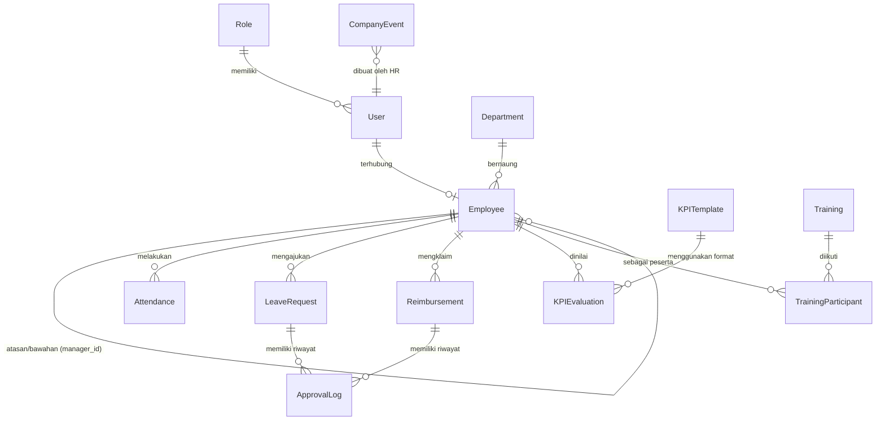

# Backend Architecture & System Overview (Jalur B — Node.js + PostgreSQL)

Dokumen ini mendefinisikan arsitektur backend, pilihan teknologi, rancangan database, struktur folder, dan strategi deployment untuk **Arryan HRIS Platform**.

Arsitektur ini dioptimalkan untuk:
1. **Model Bisnis Beli Putus**: Diserahkan ke klien untuk dijalankan di server milik klien sendiri (*Self-Hosted / On-Premise*).
2. **Skala Karyawan**: 10 – 50 pengguna (ringan, efisien, zero/low maintenance).
3. **Pengembang Pemula di Sisi Server**: Mudah dipahami, minim konfigurasi rumit, dan dapat dijalankan dengan 1 perintah.

---

## 1. Tech Stack Backend

| Komponen | Pilihan Teknologi | Alasan Pemilihan |
| :--- | :--- | :--- |
| **Runtime & Bahasa** | **Node.js (LTS) + TypeScript** | Seragam dengan Frontend (Vite/React). Memungkinkan *sharing* tipe data DTO tanpa duplikasi. |
| **Framework API** | **Fastify** (atau **Express**) | Performa tinggi, konsumsi RAM sangat kecil (~30-50MB), ekosistem plugin lengkap, dan penulisan kode simpel (mudah dimodifikasi jika ada perubahan PRD). |
| **Database** | **PostgreSQL 16** | Sangat andal, mendukung *Recursive CTE* untuk query pohon hirarki organisasi (*Tree Branch*), serta tipe data `JSONB` untuk template KPI fleksibel. |
| **ORM & Migrations** | **Prisma ORM** | *Type-safe*, otomatis menghasilkan TypeScript types, dan manajemen migrasi database sangat rapi via CLI (`prisma migrate`). |
| **Authentication** | **JWT via HttpOnly Cookie** | Aman dari risiko pencurian token XSS, stateless, tidak membebani memori server, dan frontend otomatis mengirim cookie. Password di-hash menggunakan **Argon2id** / **bcrypt**. |
| **File Storage** | **Local Docker Volume** (atau **Cloudflare R2**) | Foto selfie absensi dan dokumen KTP/NPWP disimpan di folder server privat yang hanya bisa diakses lewat endpoint terotentikasi (*Secure Proxy*). |
| **Containerization** | **Docker & Docker Compose** | Membungkus Web, API, dan Database menjadi satu kesatuan. Handover ke klien cukup via `docker compose up -d`. |

---

## 2. Struktur Repository (Monorepo Ramping)

Proyek akan ditata menjadi repositori tunggal (*Monorepo*) tanpa tool build yang rumit. Frontend yang sudah ada di `arrayan-proj` akan ditempatkan di `apps/web/`, berdampingan dengan `apps/api/`:

```text
arrayan-hris/
├── apps/
│   ├── web/                         <-- Frontend (React 19, Vite, Tailwind v4, React Router)
│   │   ├── src/
│   │   │   ├── components/
│   │   │   ├── modules/             <-- attendance, leave, kpi, training, dll.
│   │   │   ├── services/            <-- Pemanggil API (menggantikan mock)
│   │   │   └── types/
│   │   ├── package.json
│   │   └── Dockerfile.web
│   │
│   └── api/                         <-- Backend (Node.js, Fastify/Express, Prisma)
│       ├── prisma/
│       │   ├── schema.prisma        <-- Skema tabel database
│       │   └── seed.ts              <-- Data inisial (Admin, Roles, Depts)
│       ├── src/
│       │   ├── config/              <-- Env config, constants
│       │   ├── middlewares/         <-- Auth guard, RBAC check, error handler
│       │   ├── modules/             <-- Pembagian per domain modul PRD:
│       │   │   ├── auth/            <-- Login, logout, session, me
│       │   │   ├── employees/       <-- Data karyawan & tree branch hierarchy
│       │   │   ├── attendance/      <-- Clock-in/out GPS + selfie
│       │   │   ├── leave/           <-- Pengajuan cuti & alur multi-level approval
│       │   │   ├── reimbursement/   <-- Klaim biaya & bukti nota
│       │   │   ├── kpi/             <-- Template KPI, evaluasi kualitatif/kuantitatif
│       │   │   ├── training/        <-- Jadwal training, peserta, feedback remarks
│       │   │   ├── calendar/        <-- Master event kantor & kalender personal
│       │   │   └── reports/         <-- Agregasi data & ekspor (Excel/PDF)
│       │   ├── common/              <-- Helpers, file storage utility, date utils
│       │   └── server.ts            <-- Entry point server
│       ├── package.json
│       └── Dockerfile.api
│
├── docker-compose.yml               <-- Mengorkestrasi Web, API, dan Database Postgres
├── .env.example                     <-- Template variabel environment
└── docs/                            <-- Dokumentasi PRD & arsitektur
    ├── PRD.md
    ├── FRONTEND_GUIDELINES.md
    ├── BACKEND_OVERVIEW.md
    ├── SECURITY_GUIDELINES.md
    └── DEVELOPMENT_ROADMAP.md
```

---

## 3. Rancangan Skema Database (Database Blueprint)

Berikut adalah entitas inti yang dirancang di PostgreSQL melalui Prisma untuk memenuhi seluruh kebutuhan PRD v1.1:



### Detail Entitas & Relasi Kunci:

1. **`User` & `Role` (Autentikasi & RBAC)**:
   - `User`: `id`, `email`, `password_hash`, `role_id`, `is_active`, `created_at`.
   - `Role`: `id`, `code` (`SUPER_ADMIN`, `MANAGEMENT`, `SR_MANAGER`, `MANAGER`, `SUPERVISOR`, `STAFF`), `name`, `permissions` (`JSONB`).
   - *Keuntungan*: Fleksibel jika ke depan ada penambahan role baru tanpa perlu ubah tipe enum database.

2. **`Employee` (Master Data & Tree Branch)**:
   - `id`, `user_id` (opsional 1-to-1), `nik`, `full_name`, `department_id`, `manager_id` (self-referencing FK ke `Employee.id`), `job_title`, `employment_type` (`PROBATION`, `KARTAP`, `PKL`), `join_date`, `ktp_url`, `npwp_url`, `bpjs_number`.
   - **Logika Tree Branch**:
     Untuk mendapatkan silsilah atasan atau bawahan, backend menjalankan *Recursive CTE*:
     ```sql
     WITH RECURSIVE subordinates AS (
       SELECT id, full_name, manager_id FROM employees WHERE id = :currentUserId
       UNION ALL
       SELECT e.id, e.full_name, e.manager_id FROM employees e
       INNER JOIN subordinates s ON s.id = e.manager_id
     ) SELECT * FROM subordinates;
     ```

3. **`Attendance` (Presensi GPS & Selfie)**:
   - `id`, `employee_id`, `date`, `clock_in`, `clock_out`, `clock_in_lat`, `clock_in_long`, `clock_in_selfie_url`, `status` (`PRESENT`, `LATE`, `LEAVE`, `ABSENT`).

4. **`LeaveRequest` & `Reimbursement` (Multi-level Approval)**:
   - Status pengajuan: `PENDING_APPROVAL`, `APPROVED`, `REJECTED`, `CANCELLED`.
   - Tabel pendukung **`ApprovalLog`**:
     `id`, `entity_type` (`LEAVE` / `REIMBURSEMENT`), `entity_id`, `step_order` (1, 2, 3), `approver_id`, `action` (`APPROVED` / `REJECTED`), `note`, `created_at`.
   - Rantai persetujuan mengikuti hierarki atasan langsung hingga HR/Management.

5. **`KPITemplate` & `KPIEvaluation` (Kinerja Kualitatif & Kuantitatif)**:
   - `KPITemplate`: `id`, `title`, `department_id`, `indicators` (`JSONB` berisi target angka kuantitatif & deskripsi kualitatif).
   - `KPIEvaluation`: `id`, `employee_id`, `template_id`, `evaluator_id`, `period` (bulan/kuartal), `scores` (`JSONB`), `final_score`, `feedback_notes`.
   - *Visibilitas*: Mengikuti *Tree Branch* (Senior Manager hanya melihat divisi bawahannya; HR & Management melihat seluruh divisi).

6. **`Training` & `TrainingParticipant`**:
   - `Training`: `id`, `title`, `description`, `trainer`, `start_date`, `end_date`, `location`.
   - `TrainingParticipant`: `id`, `training_id`, `employee_id`, `attendance_status`, `remarks_feedback` (catatan/ulasan hasil training dari peserta).
   - Jadwal ini otomatis diproyeksikan ke kalender personal karyawan terkait.

---

## 4. Keamanan & Akses Berkas Sensitif

Karena aplikasi berjalan di server milik klien:
1. **Penyimpanan Berkas**:
   - Berkas seperti foto selfie, KTP, NPWP, dan struk reimbursement disimpan di direktori privat server (misal: `/data/uploads/`), **bukan** di folder statis publik.
2. **Endpoint Terproteksi (*Secure Stream/Proxy*)**:
   - Frontend mengakses berkas melalui endpoint API khusus:
     `GET /api/files/:fileId`
   - Backend memverifikasi cookie sesi terlebih dahulu. Hanya pemilik berkas, HR GA, atau atasannya yang diizinkan mengunduh/melihat gambar.

---

## 5. Strategi Environment (UAT vs Production) & Konfigurasi Deployment

Sistem dirancang untuk berjalan di **1 unit Virtual Private Server (VPS)** standar milik klien (Spesifikasi rekomendasi: 2 vCPU, 2 GB RAM, 20 GB Disk) dengan pemisahan lingkungan **UAT/Staging** dan **Production** (Strategi A: 1 Server, Isolasi Data).

### 5.1. Pemisahan Lingkungan (Environment Strategy)

| Parameter | Development (Lokal) | UAT / Staging | Production |
| :--- | :--- | :--- | :--- |
| **Domain Web** | `http://localhost:5173` | `https://uat.hris.arrayan.com` | `https://hris.arrayan.com` |
| **Port / Service** | `localhost:4000` (API) | Kontainer `api-uat` | Kontainer `api-prod` |
| **Database** | `hris_dev` | `hris_uat` (terisolasi) | `hris_prod` (data riil aman) |
| **Tujuan & Akses** | Koding & debugging | Testing klien, simulasi approval, verifikasi BAST | Operasional harian resmi 10-50 karyawan |
| **Cookie & SSL** | `Secure: false` | `Secure: true` (HTTPS) | `Secure: true` (HTTPS) |

### 5.2. Blueprint Docker Compose (1 Server Multi-Env)

```yaml
# docker-compose.yml (Blueprint 1 Server: DB Bersama, App Terisolasi)
services:
  # Database Utama (Menyimpan database hris_prod dan hris_uat)
  db:
    image: postgres:16-alpine
    restart: always
    environment:
      POSTGRES_USER: hris_admin
      POSTGRES_PASSWORD: ${DB_PASSWORD}
    volumes:
      - postgres_data:/var/lib/postgresql/data
    networks:
      - internal_net

  # ---------------- PRODUCTION STACK ----------------
  api-prod:
    build:
      context: ./apps/api
      dockerfile: Dockerfile
    restart: always
    environment:
      NODE_ENV: production
      DATABASE_URL: postgres://hris_admin:${DB_PASSWORD}@db:5432/hris_prod
      JWT_SECRET: ${JWT_SECRET_PROD}
      CORS_ORIGIN: https://hris.arrayan.com
    depends_on:
      - db
    volumes:
      - uploads_prod:/app/uploads
    networks:
      - internal_net

  web-prod:
    build:
      context: ./apps/web
      dockerfile: Dockerfile
    restart: always
    networks:
      - internal_net

  # ---------------- UAT / STAGING STACK ----------------
  api-uat:
    build:
      context: ./apps/api
      dockerfile: Dockerfile
    restart: always
    environment:
      NODE_ENV: staging
      DATABASE_URL: postgres://hris_admin:${DB_PASSWORD}@db:5432/hris_uat
      JWT_SECRET: ${JWT_SECRET_UAT}
      CORS_ORIGIN: https://uat.hris.arrayan.com
    depends_on:
      - db
    volumes:
      - uploads_uat:/app/uploads
    networks:
      - internal_net

  web-uat:
    build:
      context: ./apps/web
      dockerfile: Dockerfile
    restart: always
    networks:
      - internal_net

  # Reverse Proxy (Nginx) mengatur routing domain:
  # hris.arrayan.com     -> web-prod & api-prod
  # uat.hris.arrayan.com -> web-uat & api-uat
  gateway:
    image: nginx:alpine
    restart: always
    ports:
      - "80:80"
      - "443:443"
    volumes:
      - ./nginx.conf:/etc/nginx/nginx.conf:ro
      - certs_data:/etc/letsencrypt
    depends_on:
      - web-prod
      - web-uat
    networks:
      - internal_net

volumes:
  postgres_data:
  uploads_prod:
  uploads_uat:
  certs_data:

networks:
  internal_net:
    driver: bridge
```

---

## 6. Pola Integrasi ke Frontend (`src/services/`)

Frontend yang sudah dibuat di `arrayan-proj` tidak perlu dirombak tampilan UI-nya. Kita hanya memperbarui isi dari berkas service yang sudah ada:

```ts
// Contoh transisi di apps/web/src/services/employee.service.ts
import { apiClient } from './api'
import type { Employee, EmployeeQuery } from '@/types'

export const employeeService = {
  async list(query: EmployeeQuery = {}): Promise<Employee[]> {
    // Sebelumnya memanggil simulate() mock
    // Sekarang memanggil endpoint backend asli:
    const response = await apiClient.get<Employee[]>('/employees', { params: query })
    return response.data
  },
  
  async getById(id: string): Promise<Employee> {
    const response = await apiClient.get<Employee>(`/employees/${id}`)
    return response.data
  }
}
```
Komponen UI React (`EmployeeList.tsx`, `LeaveForm.tsx`, dll.) tetap memanggil fungsi yang sama secara transparan.

