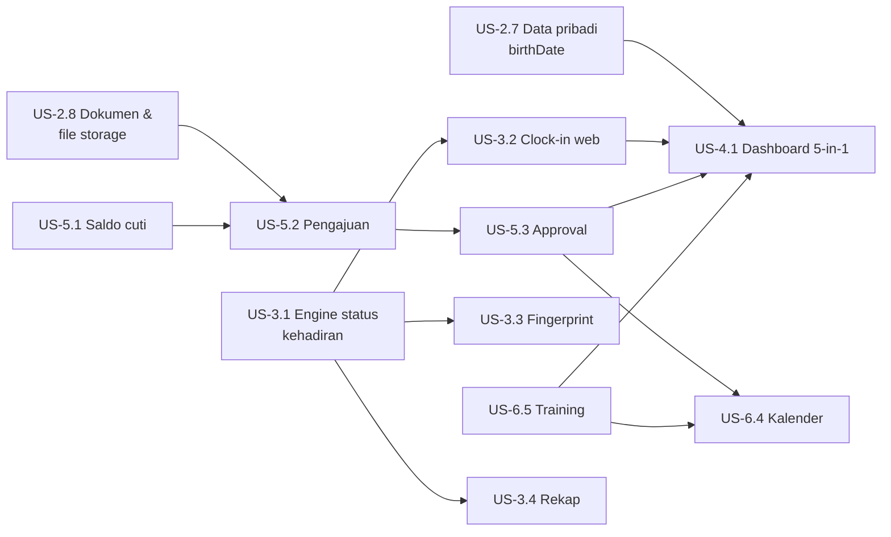

# Product Backlog — User Stories Fase 2B–6

Backlog backend Arryan HRIS setelah Fase 2 selesai. Diturunkan dari [`PRD.md`](PRD.md) v2.0 dan [`DEVELOPMENT_ROADMAP.md`](DEVELOPMENT_ROADMAP.md), memakai master data yang sudah ada ([`MASTER_DATA.md`](MASTER_DATA.md)). Disusun 12 Nov 2026, sebelum kontrak klien — **lingkup & prioritas wajib dikonfirmasi ulang bersama klien**.

**Status kesiapan**

| Tanda | Arti |
| :--- | :--- |
| 🟢 | Bisa dikerjakan sekarang (hanya butuh PostgreSQL lokal) |
| 🟡 | Butuh keputusan klien — lihat [Pertanyaan Klien](#pertanyaan-untuk-klien) (nomor `Q-…`) |
| 🔴 | Butuh infrastruktur/hardware (VPS, domain, mesin fingerprint, aplikasi mobile) |

**Konvensi semua story** (DoD sama dengan Fase 2): Zod + Swagger, `authenticate`/`authorize`, audit log untuk aksi tulis admin, test unit + integrasi, tanpa data sensitif di response, PR ke `main` dengan CI hijau.

---

## Ringkasan & Urutan yang Disarankan

| Urutan | Story | Siap |
| :--- | :--- | :---: |
| 1 | US-2.7 Data pribadi karyawan (birthDate, kontak) | ✅ |
| 2 | US-2.9 Pelacakan masa probation | ✅ |
| 3 | US-5.1 Saldo cuti tahunan | ✅ (aturan jatah sementara, Q-5) |
| 4 | US-5.2 Pengajuan cuti / izin / sakit (tanpa lampiran dulu) | ✅ |
| 5 | US-5.4 Pembatalan pengajuan | ✅ |
| 6 | US-5.3 Approval berjenjang | 🟡 Q-1…Q-4 |
| 7 | US-3.1 Engine status kehadiran | ✅ |
| 8 | US-3.2 Clock-in / clock-out aplikasi | ✅ (GPS + IP; Wi-Fi menunggu Q-6) |
| 9 | US-3.4 Rekap kehadiran | ✅ |
| 10 | US-6.5 Manajemen training & remarks | ✅ |
| 11 | US-4.1 Dashboard 5-in-1 | ✅ |
| 12 | US-6.4 Kalender perusahaan & personal | 🟢 |
| 13 | US-6.1–6.3 KPI (penilaian, visibilitas, grafik) | 🟡 Q-9 |
| 14 | US-2.8 Dokumen karyawan terenkripsi | 🟡 Q-8 |
| 15 | US-3.5 Koreksi absensi oleh HR | ✅ |
| 16 | US-6.6 Ekspor Excel / PDF | 🟡 Q-11 |
| 17 | US-5.5 Reimbursement | 🟡 Q-10 |
| 18 | US-3.3 Integrasi mesin fingerprint | 🔴 Q-7 + VPS |

---

## Fase 2B — Melengkapi Data Karyawan (gap PRD Module 1)

### US-2.7 Data pribadi karyawan ✅ selesai
**Sebagai** HR, **saya ingin** menyimpan data pribadi karyawan, **agar** widget ulang tahun dan kalender berfungsi serta profil lengkap.
- Field baru di `Employee`: `birthDate` (date), `gender`, `phone`, `personalEmail`, `address` — semua opsional; konfirmasi daftar akhir dengan klien.
- `POST/PATCH /api/employees` menerima field tersebut; perubahan masuk audit log (diff).
- `GET /api/employees/birthdays?from=&to=` — ulang tahun dalam rentang (abaikan tahun; 29 Feb dirayakan 28 Feb pada tahun non-kabisat).
- Karyawan dapat melihat profil sendiri; data kontak orang lain hanya untuk SUPER_ADMIN (nama & tanggal ulang tahun boleh publik untuk widget).

### US-2.8 Dokumen karyawan terenkripsi 🟡 Q-8
**Sebagai** HR, **saya ingin** mengunggah KTP, NPWP, BPJS Kesehatan/Ketenagakerjaan, dan Kontrak/SK, **agar** dokumen tersimpan aman di satu tempat (PRD: "Enkripsi data sensitif").
- Tabel `EmployeeDocument` (jenis dari master `DocumentType`, nomor dokumen, tanggal berlaku/kedaluwarsa, file).
- Port `FileStorage` (pola sama dengan `InvitationSender`): driver `local` (volume Docker) sekarang, `s3` nanti.
- File dienkripsi AES-256-GCM sebelum disimpan (kunci dari env `FILE_ENCRYPTION_KEY`); batas ukuran & MIME (PDF/JPG/PNG).
- Unduh hanya oleh SUPER_ADMIN dan pemilik dokumen; setiap unduhan tercatat di audit log.
- Fondasi ini dipakai ulang oleh lampiran sakit (US-5.2) dan struk reimbursement (US-5.5).

### US-2.9 Pelacakan masa probation ✅ selesai
**Sebagai** HR, **saya ingin** tahu siapa yang masa probation-nya segera berakhir, **agar** evaluasi pengangkatan tidak terlewat.
- `probationEndDate` dihitung `joinDate + 6 bulan` (PRD Module 1), dapat diubah HR.
- `GET /api/employees?probationEndingWithinDays=30`.
- `PATCH /api/employees/:id` mengubah `employmentType` → `KARTAP` (tercatat di audit log); kandidat event kalender.

---

## Fase 3 — Real-Time Attendance (PRD Module 2)

### US-3.1 Engine status kehadiran ✅ selesai
**Sebagai** sistem, **saya perlu** menentukan status harian tiap karyawan, **agar** dashboard & rekap konsisten dari sumber mana pun (aplikasi atau fingerprint).
- Tabel `AttendanceLog` (mentah: sumber `APP`/`FINGERPRINT`/`MANUAL`, waktu, lokasi/IP) dan `AttendanceDay` (ringkasan per karyawan per tanggal).
- Fungsi murni: shift (`WorkShift.startTime/endTime/lateToleranceMinutes/workDays/isOvernight`) + zona waktu kantor (`OfficeLocation.timezone`) + hari libur + cuti disetujui → `PRESENT_ON_TIME | LATE (menit) | ABSENT | ON_LEAVE | SICK | HOLIDAY | DAY_OFF`.
- Shift lintas tengah malam dihitung ke tanggal mulai shift.
- Unit test tabel kasus lengkap (batas toleransi tepat, libur, akhir pekan, overnight).
- **Implementasi:** hanya log mentah yang disimpan (`AttendanceLog`, sumber `APP`/`FINGERPRINT`/`MANUAL`); status harian **dihitung saat dibaca** sehingga otomatis benar bila cuti disetujui/dibatalkan, hari libur diedit, atau shift diubah — tanpa tabel ringkasan & tanpa proses hitung ulang. Log masuk = log pertama, pulang = log terakhir dalam jendela shift (4 jam sebelum mulai s.d. 8 jam setelah selesai). Terlambat dihitung dari jam mulai shift bila melewati toleransi. Karyawan tanpa shift memakai 08:00–17:00 Senin–Jumat, toleransi 15 menit. `GET /api/attendance/me` (bagian awal US-3.4) menampilkan status per hari + ringkasan.

### US-3.2 Clock-in / clock-out lewat aplikasi ✅ selesai (GPS + IP kantor; Wi-Fi/BSSID menunggu Q-6)
**Sebagai** karyawan, **saya ingin** absen dari aplikasi hanya saat berada di kantor, **agar** absensi tidak bisa dicurangi dari rumah.
- `POST /api/attendance/clock-in` / `clock-out` dengan koordinat GPS.
- Diterima bila jarak (haversine) ke `OfficeLocation` karyawan ≤ `radiusMeters`, **atau** jaringan kantor cocok (lihat Q-6).
- Maks. satu clock-in & satu clock-out per hari kerja; duplikat → 409; di luar radius → 422 dengan jarak terukur.
- Waktu dari server (bukan klien); status terlambat langsung dihitung via US-3.1.
- ⚠️ **Keterbatasan web**: browser tidak bisa membaca SSID/BSSID Wi-Fi. Alternatif untuk web: daftar IP publik kantor (`OfficeLocation.allowedIpRanges`). BSSID hanya untuk aplikasi mobile native.
- **Implementasi:** `POST /api/attendance/clock-in` & `/clock-out` — diterima bila GPS ≤ `radiusMeters` (haversine) **atau** IP termasuk `allowedIpRanges` (IP/CIDR, IPv4 & IPv6; field baru di master kantor). Satu IN & satu OUT per shift (shift malam: clock-out pagi milik shift kemarin), waktu dari server, pengajuan bersamaan diserialkan. Log menyimpan arah (`IN`/`OUT`), cara verifikasi (`GPS`/`IP_ALLOWLIST`), koordinat, akurasi, dan IP. Verifikasi Wi-Fi BSSID (aplikasi mobile) menyusul setelah Q-6.

### US-3.3 Integrasi mesin fingerprint 🔴 Q-7 + VPS
**Sebagai** sistem, **saya ingin** menerima log dari mesin fingerprint kantor secara otomatis, **agar** kehadiran terverifikasi tanpa input manual.
- Master `AttendanceDevice` (kode, lokasi, API key ter-hash) dan pemetaan `deviceUserId → employeeId`.
- `POST /api/attendance/devices/sync` — autentikasi per perangkat, idempoten (log duplikat diabaikan), memicu US-3.1.
- Protokol tergantung merek (mis. ZKTeco ADMS push / pull via SDK) — butuh endpoint publik (VPS) atau agent di jaringan kantor.

### US-3.4 Rekap kehadiran ✅ selesai
**Sebagai** karyawan/atasan/HR, **saya ingin** melihat rekap kehadiran, **agar** keterlambatan & ketidakhadiran terpantau.
- `GET /api/attendance/me?month=` (diri sendiri), `GET /api/attendance/team?month=` (bawahan di subtree, reuse pohon organisasi), `GET /api/attendance?month=&departmentId=` (SUPER_ADMIN/Management).
- Ringkasan bulanan: hari hadir, terlambat (total menit), absen, cuti, sakit.
- **Implementasi:** `GET /api/attendance/me`, `/team` (seluruh bawahan semua level), `/` (permission `all`/`company.read_all` — SUPER_ADMIN & Management; filter departemen + sub-departemen, paginasi), `/employees/:id` (diri sendiri, atasan di rantai atas, atau HR/Management; lainnya 404). Opsi `includeDays=true` untuk status per hari. Karyawan yang keluar di tengah rentang tetap direkap sampai tanggal keluar. Query di-batch per jenis data (bukan per karyawan).

### US-3.5 Koreksi absensi oleh HR ✅ selesai
**Sebagai** HR, **saya ingin** mengoreksi absensi (lupa clock-out, mesin rusak), **agar** rekap akurat.
- `POST /api/attendance/corrections` (sumber `MANUAL`, wajib alasan) — tercatat di audit log; status harian dihitung ulang.
- **Implementasi:** tambah log manual (`POST /corrections`), batalkan log salah (`POST /logs/:id/void` — tetap tersimpan, tidak dihitung engine), dan lihat log mentah (`GET /logs`, HR atau diri sendiri, opsi `includeVoided`). Waktu dicek: tidak di masa depan, maks. 1 tahun lalu, di dalam masa kerja.

---

## Fase 5 — Cuti, Izin & Approval (PRD Module 3 & 5 sumber data)

### US-5.1 Saldo cuti tahunan ✅ selesai (aturan jatah sementara — menunggu Q-5)
**Sebagai** karyawan, **saya ingin** melihat sisa jatah cuti (PRD: "cek sisa jatah cuti"), **agar** bisa merencanakan cuti.
- Tabel `LeaveBalance` (karyawan, `LeaveType`, tahun, jatah, terpakai, penyesuaian).
- Jatah awal dari `LeaveType.defaultQuota`; aturan prorata tahun pertama & carry-over sesuai Q-5.
- Cuti bersama (`Holiday.kind = COLLECTIVE_LEAVE`) memotong cuti tahunan.
- `GET /api/leaves/balance` (sendiri), `GET /api/leaves/balance/:employeeId` dan `POST /api/leaves/balance/adjustments` (HR, audit log).
- **Implementasi:** saldo dihitung (tidak disimpan) = jatah + penyesuaian − cuti bersama − APPROVED − PENDING. Aturan jatah ada di satu fungsi `entitlementFor()` ([`leave.rules.ts`](../src/modules/leave/leave.rules.ts)); default sementara: penuh `defaultQuota` per tahun kalender, tanpa prorata/carry-over. Jenis dengan `deductsAnnualLeave` memakai saldo cuti tahunan.

### US-5.2 Pengajuan cuti / izin / sakit ✅ selesai (lampiran menyusul — 🟡 Q-8)
**Sebagai** karyawan, **saya ingin** mengajukan cuti/izin/sakit, **agar** ketidakhadiran tercatat resmi.
- `POST /api/leaves` (jenis, tanggal mulai–selesai, alasan, lampiran bila `LeaveType.requiresAttachment`).
- Jumlah hari dihitung dari hari kerja shift karyawan, tidak termasuk hari libur.
- Tolak: tumpang tindih dengan pengajuan lain, saldo kurang (bila berkuota), tanggal tidak valid.
- `GET /api/leaves/me`, `GET /api/leaves/:id`, `GET /api/leaves` (HR).
- **Implementasi:** pembagian hari per tahun disimpan saat diajukan (`daysByYear`) agar saldo tidak berubah bila hari libur diedit belakangan; pengajuan per karyawan diserialkan (advisory lock) sehingga pengajuan bersamaan tidak melampaui saldo. **Asumsi:** cuti melahirkan dihitung hari kalender, jenis lain hari kerja shift (default Senin–Jumat bila tanpa shift). Jenis yang mensyaratkan lampiran ditandai `attachmentRequired: true` sampai US-2.8 tersedia.

### US-5.3 Approval berjenjang 🟡 Q-1…Q-4
**Sebagai** atasan, **saya ingin** menyetujui/menolak pengajuan bawahan, **agar** approval mengikuti rantai organisasi (PRD: approval line / tree branch).
- Rantai approver diturunkan dari `managerId` ke atas sebanyak N level (konfigurasi per `LeaveType`, sesuai Q-1).
- `GET /api/approvals/pending`, `POST /api/approvals/:id/approve|reject` (catatan wajib saat menolak).
- Status: `PENDING → APPROVED/REJECTED`; saldo dipotong saat final approved.
- Penanganan tanpa atasan, override HR, delegasi sesuai Q-2…Q-4. Semua keputusan tercatat di audit log.

### US-5.4 Pembatalan pengajuan ✅ selesai
- Karyawan membatalkan pengajuan miliknya selama masih `PENDING`; setelah `APPROVED` hanya HR (saldo dikembalikan, audit log).

### US-5.5 Reimbursement 🟡 Q-10
**Sebagai** karyawan, **saya ingin** mengajukan klaim biaya dengan bukti struk, **agar** penggantian diproses berjenjang.
- Ada di roadmap awal tetapi **tidak** di daftar modul PRD v2.0 → konfirmasi lingkup.
- Kategori klaim (master), nominal, tanggal, struk (US-2.8), approval memakai mesin US-5.3.

---

## Fase 4 — Dashboard 5-in-1 (PRD Module 3)

### US-4.1 Widget harian ✅ selesai
**Sebagai** karyawan (semua level, PRD), **saya ingin** melihat ringkasan hari ini dalam satu layar.
- `GET /api/dashboard/today` → `{ late[], onLeave[], sick[], birthdays[], trainings[] }` berdasarkan tanggal zona waktu kantor.
  1. **Telat hari ini** — `AttendanceDay.status = LATE` (+ menit).
  2. **Cuti hari ini** — pengajuan `APPROVED` kategori cuti yang mencakup hari ini.
  3. **Sakit hari ini** — pengajuan kategori `SICK` hari ini.
  4. **Birthday hari ini** — dari `birthDate` (US-2.7).
  5. **Jadwal training** — hari ini & N hari ke depan (US-6.5).
- Hanya data minimum (nama, jabatan, departemen) — tanpa alasan cuti/sakit (privasi). Karyawan nonaktif dikecualikan.
- Satu request, target < 300 ms untuk 50 karyawan.
- **Implementasi:** `GET /api/dashboard/today?date=&upcomingTrainingDays=` (default hari ini, 7 hari). Cuti = hanya `APPROVED` (PRD: "telah disetujui"); **sakit = `PENDING` + `APPROVED`** (PRD: "yang mengajukan izin sakit"), dengan field `status`. Telat dihitung engine US-3.1 (karyawan aktif). Training `SCHEDULED` yang berlangsung hari ini s.d. +N hari, dengan `isParticipant`. Tanpa alasan cuti/sakit & tanpa tahun lahir. Uji lokal: ±10 ms.

---

## Fase 6 — KPI, Kalender & Training (PRD Module 4, 5, 6)

### US-6.1 Penilaian KPI 🟡 Q-9
**Sebagai** atasan, **saya ingin** menilai KPI bawahan memakai template, **agar** kinerja terukur kuantitatif & kualitatif.
- `KpiAssignment` (karyawan, template, periode) — template dipilih otomatis dari jabatan/departemen (`KpiTemplate`), dapat diganti HR.
- Input capaian per indikator: kuantitatif (nilai vs target), kualitatif (skala sesuai Q-9 + catatan).
- Skor akhir = Σ(skor indikator × bobot) / 100; status `DRAFT → SUBMITTED → REVIEWED`.

### US-6.2 Visibilitas berjenjang 🟢
- Hasil KPI dapat dilihat: karyawan sendiri, atasan di rantai atas (subtree), SUPER_ADMIN & Management (semua) — PRD "Cascading Visibility". Reuse pohon organisasi.

### US-6.3 Data grafik progres KPI 🟢
- `GET /api/kpi/progress?employeeId=&from=&to=` → deret skor per periode (bulanan/kuartalan) untuk chart FE; versi agregat per tim.

### US-6.4 Kalender perusahaan & personal 🟢
**Sebagai** karyawan, **saya ingin** satu kalender berisi libur, ulang tahun, event kantor, training, dan cuti saya.
- Master/entitas `CalendarEvent` (event kantor) — input hanya SUPER_ADMIN (PRD "Pencegahan Input").
- `GET /api/calendar?from=&to=` menggabungkan: `Holiday`, ulang tahun (US-2.7), `CalendarEvent`, training yang diikuti (US-6.5), cuti/izin pribadi (US-5.2).
- `?view=master` (SUPER_ADMIN): seluruh jadwal karyawan.

### US-6.5 Manajemen training & remarks ✅ selesai
**Sebagai** HR, **saya ingin** menjadwalkan training dan peserta, **agar** jadwal muncul di dashboard & kalender peserta.
- `Training` (judul, `TrainingCategory`, penyelenggara internal/eksternal, lokasi, mulai–selesai) + `TrainingParticipant`.
- Peserta mengisi **remarks/feedback** setelah training selesai (PRD Module 6).
- `GET /api/trainings/report` — histori & rekap per karyawan/kategori/periode.
- **Implementasi:** `POST/PATCH /api/trainings` (HR; `status: CANCELLED` untuk membatalkan, tetap tersimpan), `PUT /:id/participants` (ganti daftar; peserta yang sudah memberi remarks tidak bisa dikeluarkan), `PATCH /:id/participants/:employeeId` (kehadiran), `PUT /:id/remarks` (peserta, setelah selesai, rating 1–5), `GET /` agenda untuk semua karyawan (`mine`, rentang tanggal), `GET /:id` (remarks hanya terlihat oleh HR & peserta ybs), `GET /report` (permission `all`/`company.read_all`). Audit log untuk semua aksi HR.

### US-6.6 Ekspor Excel / PDF 🟡 Q-11
- Ekspor rekap absensi, cuti, dan training ke `.xlsx` dan PDF (PRD Module 6), difilter periode & departemen; khusus SUPER_ADMIN/Management; dicatat di audit log.
- "Payroll" disebut di PRD tetapi tidak ada modul payroll → lihat Q-11.

---

## Pertanyaan untuk Klien

Q-1 s.d. Q-4 juga tercatat di roadmap (keputusan bisnis Fase 2).

| No | Pertanyaan | Mempengaruhi |
| :--- | :--- | :--- |
| Q-1 | Minimal berapa level approval cuti/izin? Berbeda per jenis cuti? | US-5.3 |
| Q-2 | Siapa approver bila karyawan tidak punya atasan (level Management)? | US-5.3 |
| Q-3 | Apakah HR/Super Admin dapat memberi approval akhir / override? | US-5.3 |
| Q-4 | Bila atasan berhalangan, apakah approval didelegasikan ke atasan berikutnya? | US-5.3 |
| Q-5 | Jatah cuti tahun pertama prorata? Sisa cuti bisa dibawa ke tahun berikut (carry-over), berapa maks.? Kapan reset (1 Jan / tanggal masuk)? | US-5.1 |
| Q-6 | Absen lewat **web** atau **aplikasi mobile**? Web tidak bisa membaca Wi-Fi (SSID/BSSID) — apakah cukup GPS radius + IP publik kantor? | US-3.2 |
| Q-7 | Merek & model mesin fingerprint, dan cara kirim datanya (push ke server / tarik via SDK)? | US-3.3 |
| Q-8 | Dokumen apa saja yang wajib disimpan, dan di mana (disk VPS atau cloud storage)? Berapa lama disimpan setelah karyawan keluar? | US-2.8, lampiran US-5.2 |
| Q-9 | Skala penilaian kualitatif KPI (1–5? A–E?) dan siapa yang menilai (atasan langsung saja atau berjenjang)? | US-6.1 |
| Q-10 | Apakah reimbursement termasuk lingkup proyek? Kategori & batas nominal? | US-5.5 |
| Q-11 | "Export payroll" di PRD — apakah ada modul penggajian, atau cukup ekspor data kehadiran/cuti untuk diolah di sistem payroll lain? | US-6.6 |
