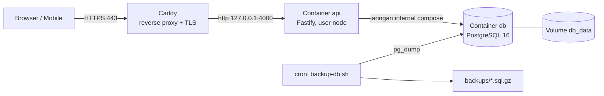

# Deployment — Arryan HRIS Backend

Panduan menjalankan backend di server (VPS) memakai Docker. Semua yang ada di dokumen ini **sudah diuji di lokal** dengan Docker Desktop (mode `NODE_ENV=production` sungguhan), kecuali bagian yang ditandai ⏳ — bagian tersebut butuh VPS/domain dan dikumpulkan di [§9 Checklist Saat VPS Siap](#9-checklist-saat-vps-siap).

| Berkas | Fungsi |
| :--- | :--- |
| [`Dockerfile`](../Dockerfile) | Image production multi-stage (Node 22 Alpine, user non-root `node`, healthcheck `/health`) |
| [`docker/entrypoint.sh`](../docker/entrypoint.sh) | Menjalankan `prisma migrate deploy` sebelum server start (idempoten) |
| [`docker-compose.prod.yml`](../docker-compose.prod.yml) | Stack API + PostgreSQL 16; DB tidak dipublikasikan, API hanya di `127.0.0.1` |
| [`.env.production.example`](../.env.production.example) | Template konfigurasi production |
| [`scripts/backup-db.sh`](../scripts/backup-db.sh) / [`restore-db.sh`](../scripts/restore-db.sh) | Backup harian & pemulihan database |
| [`deploy/Caddyfile`](../deploy/Caddyfile) | ⏳ Template reverse proxy HTTPS |

---

## 1. Arsitektur di VPS



- Port yang terbuka ke internet hanya **80/443** (Caddy). API & DB tidak bisa diakses langsung dari luar.
- Migrasi database berjalan otomatis setiap container API start.

## 2. Prasyarat VPS

- Ubuntu 22.04/24.04 (atau Debian 12), minimal 1 vCPU / 1 GB RAM / 20 GB disk (10–50 karyawan).
- Docker Engine + Docker Compose plugin.
- Domain yang A-record-nya mengarah ke IP VPS (untuk HTTPS).

## 3. Deploy pertama

```bash
# 1) Ambil kode
sudo mkdir -p /opt/arrayan-be && sudo chown $USER /opt/arrayan-be
git clone https://github.com/Nongslab/arrayan-be.git /opt/arrayan-be
cd /opt/arrayan-be

# 2) Konfigurasi — isi semua nilai GANTI_..., domain https, dan kredensial Super Admin
cp .env.production.example .env.production
chmod 600 .env.production
#   generate secret: openssl rand -hex 32   (JWT_SECRET, COOKIE_SECRET, POSTGRES_PASSWORD — semuanya berbeda)

# 3) Build & jalankan
docker compose --env-file .env.production -f docker-compose.prod.yml up -d --build

# 4) Tunggu sehat
docker compose --env-file .env.production -f docker-compose.prod.yml ps   # api & db: healthy

# 5) Seed awal (SEKALI SAJA): role, master data (create-only), akun Super Admin dari env
docker compose --env-file .env.production -f docker-compose.prod.yml \
  run --rm -e SKIP_MIGRATIONS=true api node dist-seed/seed.js

# 6) Hapus SUPER_ADMIN_PASSWORD dari .env.production setelah seed berhasil
```

Server **menolak start** bila konfigurasi production tidak aman (secret contoh, origin/URL bukan https, dsb.) dan menyebutkan semua masalahnya — cek `docker compose ... logs api`.

### Perilaku seed di production
- Master data: **create-only** — hanya menambah yang belum ada; perubahan HR lewat API tidak ditimpa. (Paksa timpa: `-e SEED_OVERWRITE_MASTER=true`.)
- Super Admin: email & password **wajib** dari `SUPER_ADMIN_EMAIL` / `SUPER_ADMIN_PASSWORD` (≥ 12 karakter, huruf besar/kecil, angka, simbol). Password tidak pernah dicetak. Akun yang sudah ada tidak diubah.
- Aman diulang (idempoten).

## 4. Update aplikasi (rilis baru)

```bash
cd /opt/arrayan-be
./scripts/backup-db.sh                       # selalu backup dulu
git pull origin main
docker compose --env-file .env.production -f docker-compose.prod.yml up -d --build
docker compose --env-file .env.production -f docker-compose.prod.yml logs --tail 50 api
```

Migrasi baru diterapkan otomatis saat container API start. Request yang sedang berjalan diselesaikan dulu (graceful shutdown, maks. 10 detik).

## 5. Backup & restore

```bash
./scripts/backup-db.sh                                   # → backups/arrayan_YYYYMMDD_HHMMSS.sql.gz
./scripts/restore-db.sh backups/arrayan_20261112_020000.sql.gz   # minta konfirmasi "yes"
```

- Backup ditulis ke file sementara lalu di-rename (backup gagal tidak meninggalkan file rusak); backup lebih tua dari `BACKUP_KEEP_DAYS` (default 14) dihapus.
- Restore: hentikan API → kosongkan schema → pulihkan → jalankan API (migrasi menyusul otomatis).
- ⏳ Jadwal harian & salinan off-site: lihat §9.

## 6. Reverse proxy HTTPS (⏳ template)

[`deploy/Caddyfile`](../deploy/Caddyfile) — Caddy mengurus sertifikat Let's Encrypt otomatis. Ganti domain, salin ke `/etc/caddy/Caddyfile`, `sudo systemctl reload caddy`. Pastikan `.env.production` berisi `TRUST_PROXY=true` agar IP klien asli tercatat (login limiter & audit log).

## 7. Operasional

| Kebutuhan | Perintah (prefix `docker compose --env-file .env.production -f docker-compose.prod.yml`) |
| :--- | :--- |
| Status & health | `ps` |
| Log API | `logs -f api` (JSON; token/password/cookie disamarkan) |
| Restart API | `restart api` |
| Stop semua | `down` (data aman di volume `db_data`; **jangan** pakai `down -v`) |
| Shell psql | `exec db sh -c 'psql -U "$POSTGRES_USER" -d "$POSTGRES_DB"'` |
| Swagger sementara | set `DOCS_ENABLED=true` → `up -d` (matikan lagi setelahnya) |

## 8. Hasil uji lokal (12 Nov 2026)

Stack ini dijalankan di Docker Desktop dengan `NODE_ENV=production`, secret acak, dan URL https contoh:

- Image build sukses; container berjalan sebagai `uid=1000(node)`; api & db **healthy**.
- 6 migrasi diterapkan otomatis ke DB kosong; restart berikutnya: *"No pending migrations"*.
- Seed: password lemah ditolak; mode create-only; password tidak dicetak; seed ulang tidak mengubah apa pun.
- HTTP: `/health` 200, `/docs` 404 (nonaktif), login Super Admin 200 dengan cookie `Secure; SameSite=None`, buat karyawan + akun 201 **tanpa** link aktivasi di response, audit log tercatat, token rusak 401.
- Log production tidak memuat token/link (0 kemunculan) dan menampilkan peringatan `INVITATION_DRIVER=log`.
- Backup → tambah data → restore: data kembali ke kondisi backup, API healthy.
- `stop`: log *"Menerima sinyal, menutup server..."*, exit code 0.

## 9. Checklist Saat VPS Siap

Langkah yang belum bisa dieksekusi tanpa VPS/domain. Urutkan dari atas.

- [ ] **Data dari klien/tim**: IP & akses SSH VPS, domain API (mis. `api.hris.<domain>`), domain FE, email Super Admin pertama (HR).
- [ ] **Hardening VPS**: user non-root + SSH key, nonaktifkan login password SSH, firewall `ufw allow OpenSSH 80 443`, `unattended-upgrades`.
- [ ] **Install Docker** Engine + compose plugin (dokumentasi resmi Docker untuk Ubuntu).
- [ ] **Deploy pertama** sesuai §3 (clone, `.env.production`, `up -d --build`, seed sekali, hapus `SUPER_ADMIN_PASSWORD`).
- [ ] **HTTPS**: install Caddy, pasang `deploy/Caddyfile` dengan domain asli, cek `https://<domain-api>/health` → 200 dan sertifikat valid.
- [ ] **CORS & link**: isi `CORS_ORIGIN` / `APP_BASE_URL` dengan domain FE asli; uji login dari FE (cookie `SameSite=None; Secure`).
- [ ] **Backup terjadwal**: `crontab -e` → `0 2 * * * cd /opt/arrayan-be && ./scripts/backup-db.sh >> backups/backup.log 2>&1`; uji restore sekali di VPS.
- [ ] **Backup off-site**: salin `backups/` ke penyimpanan lain (mis. S3-compatible / Google Drive via `rclone`) — tentukan bersama klien.
- [ ] **Driver email/WA**: pilih provider (SMTP/Resend/WhatsApp), tambah driver di `src/lib/notifications/`, set `INVITATION_DRIVER` — sampai ini selesai, undangan aktivasi & reset password tidak terkirim (server memberi peringatan di log).
- [ ] **CD (opsional)**: GitHub Actions deploy via SSH (secret `VPS_HOST`, `VPS_USER`, `VPS_SSH_KEY`) menjalankan langkah §4 setelah merge ke `main`.
- [ ] **Monitoring (opsional)**: uptime check eksternal ke `/health` (mis. UptimeRobot) + notifikasi.
- [ ] **Kebijakan klien**: retensi audit log & backup, siapa pemegang akses Super Admin/VPS.
