# Master Data — Arryan HRIS Backend

Dokumen referensi teknis master data untuk developer BE/FE: struktur tabel, relasi, alur data, dan aturan yang wajib dipatuhi saat membangun API master data dan modul transaksi di fase berikutnya.

- **Sumber kebenaran schema**: [`prisma/schema.prisma`](../prisma/schema.prisma) §4 *MASTER DATA*
- **Migrasi**: [`prisma/migrations/20261110230000_add_master_data`](../prisma/migrations/20261110230000_add_master_data/migration.sql)
- **Data seed**: [`prisma/seed-data/master.ts`](../prisma/seed-data/master.ts) (dieksekusi oleh [`prisma/seed.ts`](../prisma/seed.ts))
- **Tes invarian seed**: [`prisma/seed-data/master.test.ts`](../prisma/seed-data/master.test.ts)
- **Aturan arsitektur**: `AGENTS.md` §1 *Master Data Design Invariants*

> Status: **schema + migrasi + seed selesai**. API CRUD master data (`/api/master/*`) belum dibuat — lihat [§8 Kontrak & Aturan untuk API Berikutnya](#8-kontrak--aturan-untuk-api-berikutnya).

---

## Daftar Isi
1. [Konvensi](#1-konvensi)
2. [Entity Relationship Diagram](#2-entity-relationship-diagram)
3. [Katalog Tabel](#3-katalog-tabel)
4. [Siklus Hidup Master Data](#4-siklus-hidup-master-data)
5. [Alur Migrasi & Backfill](#5-alur-migrasi--backfill)
6. [Alur Seed](#6-alur-seed)
7. [Pemakaian Master Data per Modul](#7-pemakaian-master-data-per-modul)
8. [Kontrak & Aturan untuk API Berikutnya](#8-kontrak--aturan-untuk-api-berikutnya)
9. [Cara Menambah / Mengubah Master Data](#9-cara-menambah--mengubah-master-data)

---

## 1. Konvensi

Setiap tabel master **wajib** memiliki kolom berikut (AGENTS.md §1):

| Kolom Prisma | Kolom DB | Tipe | Keterangan |
| :--- | :--- | :--- | :--- |
| `id` | `id` | `TEXT` (UUID) | Primary key, di-generate Prisma Client |
| `code` | `code` | `TEXT UNIQUE` | Kode bisnis stabil, format `UPPER_SNAKE` (`^[A-Z0-9]+(_[A-Z0-9]+)*$`). Dipakai seed, integrasi, dan dropdown FE |
| `name` | `name` | `TEXT` | Label tampilan, boleh diubah kapan saja |
| `isActive` | `is_active` | `BOOLEAN` default `true` | Soft-deactivate. **Jangan hapus** row yang sudah direferensikan |
| `createdAt` / `updatedAt` | `created_at` / `updated_at` | `TIMESTAMP(3)` | Timestamp standar |

Aturan relasi:
- Seluruh FK dari `employees` / tabel transaksi ke master menggunakan **`ON DELETE RESTRICT`** → database menolak penghapusan master yang masih dipakai.
- Pengecualian: `kpi_indicators.template_id` memakai **`CASCADE`** karena indikator adalah bagian (child) dari template, bukan master mandiri.
- `code` bersifat **immutable** setelah dipakai (lihat §8) — `name` yang boleh diubah.

---

## 2. Entity Relationship Diagram

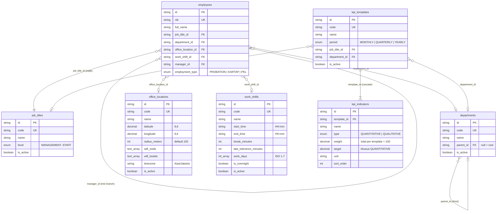

Tabel master **mandiri** (belum direferensikan FK; akan dipakai modul transaksi di fase berikutnya):

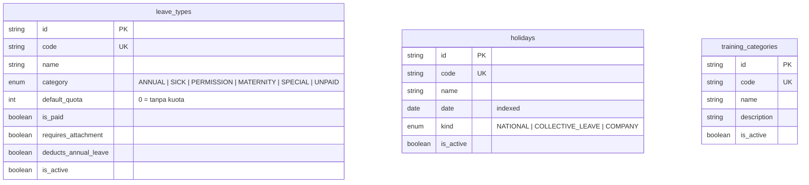

---

## 3. Katalog Tabel

| Model Prisma | Tabel | Dipakai oleh (fase) | Field khusus & arti |
| :--- | :--- | :--- | :--- |
| `Department` | `departments` | Employee, Tree Branch, KPI, laporan (Fase 2, 6) | `parentId` → divisi berjenjang. `null` = root |
| `JobTitle` | `job_titles` | Employee, approval line, KPI (Fase 2, 5, 6) | `level`: posisi di hierarki PRD. **Bukan** hak akses — RBAC tetap lewat `roles` |
| `OfficeLocation` | `office_locations` | Clock-in geofence & Wi-Fi lock (Fase 3) | `latitude`/`longitude` + `radiusMeters`; `wifiSsids`/`wifiBssids` daftar jaringan resmi; `timezone` untuk konversi jam shift |
| `WorkShift` | `work_shifts` | Kalkulasi telat, dashboard "Yang Telat" (Fase 3, 4) | `startTime`/`endTime` `HH:mm` waktu lokal kantor; `lateToleranceMinutes`; `workDays` ISO (1=Senin); `isOvernight` jika `endTime` jatuh di hari berikutnya |
| `LeaveType` | `leave_types` | Pengajuan cuti, saldo, dashboard "Cuti/Sakit Hari Ini" (Fase 4, 5) | `category` untuk logika bisnis (jangan cek berdasarkan `name`); `defaultQuota` hari/tahun; `deductsAnnualLeave` |
| `Holiday` | `holidays` | Hitung hari kerja cuti, kalender (Fase 5, 6) | `kind = COLLECTIVE_LEAVE` → cuti bersama, memotong saldo cuti tahunan |
| `TrainingCategory` | `training_categories` | Modul training & laporan (Fase 6) | — |
| `KpiTemplate` | `kpi_templates` | Evaluasi KPI (Fase 6) | `jobTitleId` / `departmentId` opsional → cakupan template (lihat §7.4) |
| `KpiIndicator` | `kpi_indicators` | Evaluasi KPI (Fase 6) | `weight` total 100 per template; `target`+`unit` hanya untuk `QUANTITATIVE` |

Enum yang ditambahkan: `HierarchyLevel`, `LeaveCategory`, `HolidayKind`, `KpiPeriod`, `KpiIndicatorType`.

---

## 4. Siklus Hidup Master Data

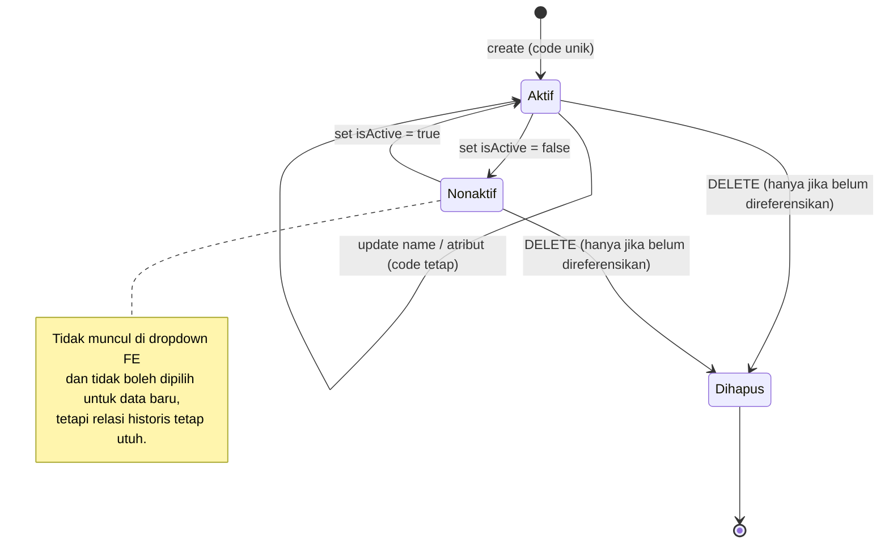

Keputusan saat admin ingin "menghapus" master data:

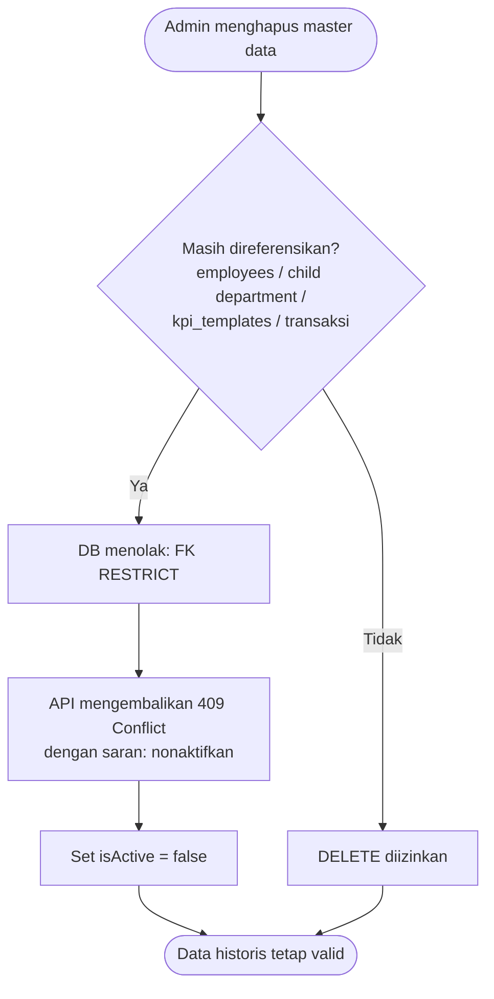

---

## 5. Alur Migrasi & Backfill

Migrasi `20261110230000_add_master_data` mengubah `employees.job_title` / `employees.department` (free-text) menjadi FK **tanpa kehilangan data**. SQL hasil `prisma migrate diff` di-edit manual sesuai urutan berikut:

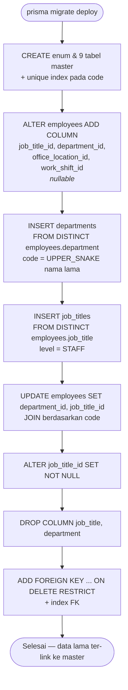

Contoh konversi kode: `"HR & System Admin"` → `HR_SYSTEM_ADMIN`, `"HR GA"` → `HR_GA`.

> Catatan: database yang dimigrasi dari data lama dapat memiliki master hasil backfill (mis. department `HR_GA`) di samping master seed (`HRD`). Seed tidak menimpa FK karyawan yang sudah terisi. Rapikan via aplikasi (pindahkan karyawan → nonaktifkan master lama) atau `prisma migrate reset` di lingkungan dev.

---

## 6. Alur Seed

`npm run prisma:seed` bersifat **idempotent** — semua entri di-`upsert` berdasarkan `code`, aman dijalankan berulang kali.

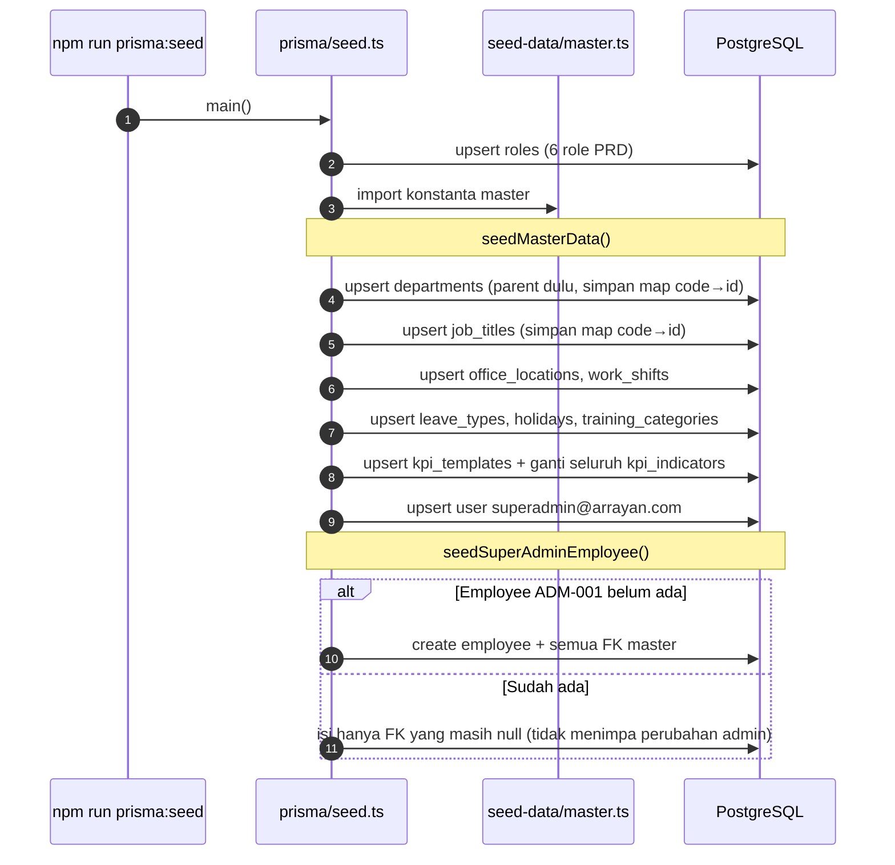

Struktur department hasil seed:

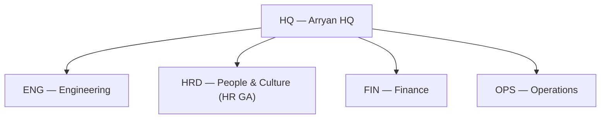

Ringkasan isi seed:

| Entitas | Kode yang di-seed |
| :--- | :--- |
| Department | `HQ`, `ENG`, `HRD`, `FIN`, `OPS` |
| JobTitle (level) | `DIRECTOR` (MANAGEMENT), `SR_MANAGER`, `MANAGER`, `SUPERVISOR`, `STAFF`, `HR_SYSTEM_ADMIN` (STAFF), `INTERN` (STAFF) |
| OfficeLocation | `HO` — ⚠️ **koordinat & Wi-Fi placeholder**, ganti sebelum go-live |
| WorkShift | `REGULAR` 08:00–17:00, istirahat 60 mnt, toleransi 15 mnt, Senin–Jumat |
| LeaveType | `ANNUAL` 12 hari, `SICK` 6 (lampiran wajib), `MATERNITY` 90, `PERMISSION`, `UNPAID` |
| Holiday | 6 libur 2026–2027 (4 nasional, 2 cuti bersama) |
| TrainingCategory | `INTERNAL`, `EXTERNAL`, `CERTIFICATION`, `ONBOARDING` |
| KpiTemplate | `STAFF_GENERAL` (QUARTERLY, jabatan `STAFF`, 3 indikator: 30/40/30) |
| Super Admin `ADM-001` | `HR_SYSTEM_ADMIN` · `HRD` · `HO` · `REGULAR` |

---

## 7. Pemakaian Master Data per Modul

Alur berikut adalah **rancangan** pemakaian master data oleh modul fase berikutnya — menjadi acuan saat implementasi API.

### 7.1 Clock-in (Fase 3) — `OfficeLocation` + `WorkShift`

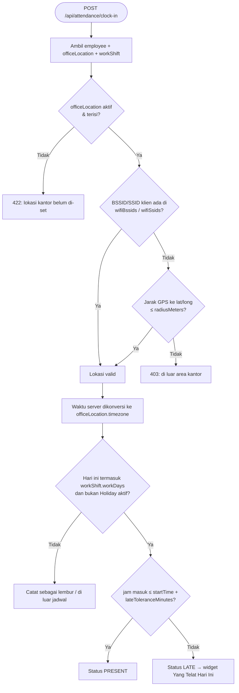

### 7.2 Pengajuan Cuti (Fase 5) — `LeaveType` + `Holiday` + `WorkShift`

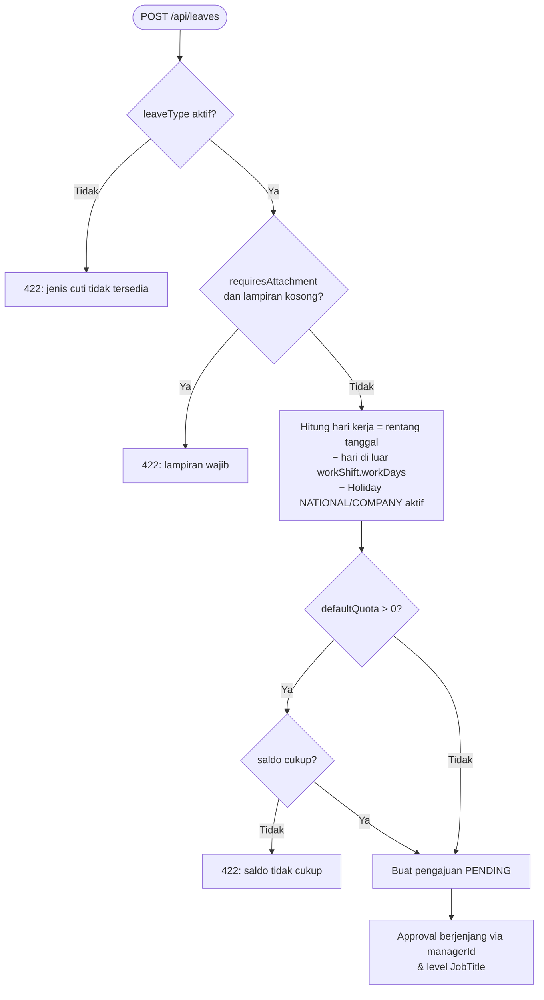

Catatan: `Holiday.kind = COLLECTIVE_LEAVE` mengurangi saldo cuti `ANNUAL` secara otomatis (bukan sebagai hari libur bebas), dan `LeaveType.category = SICK` menjadi sumber widget *Yang Sakit Hari Ini*.

### 7.3 Provisioning Karyawan (Fase 2, US-2.2) — validasi FK master

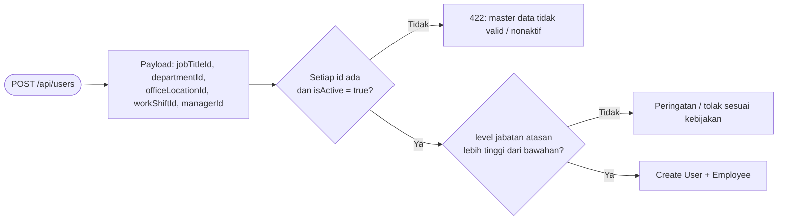

### 7.4 Resolusi Template KPI (Fase 6)

Template dipilih dari yang **paling spesifik** ke yang paling umum:

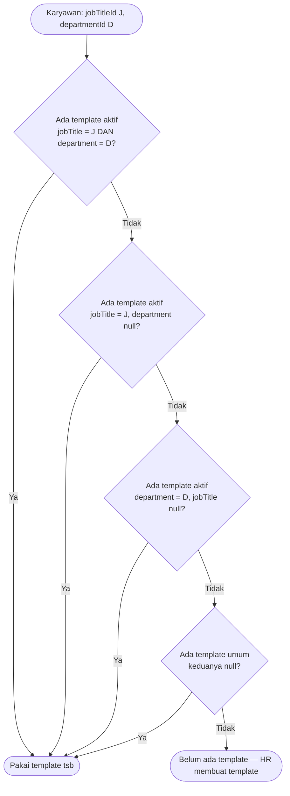

---

## 8. API Master Data & Aturan Validasi

### Endpoint

Tersedia di `/api/master/<entitas>` untuk `departments`, `job-titles`, `office-locations`, `work-shifts`, `leave-types`, `holidays`, `training-categories`, `kpi-templates`. Kontrak lengkap + contoh body: Swagger `/docs` (tag `Master: …`).

| Method & Path | Akses | Keterangan |
| :--- | :--- | :--- |
| `GET /api/master/<entitas>` | Semua user login | List aktif. Query: `q` (cari code/name), `page`, `limit` (≤ 200, default 100), `includeInactive=true` (hanya `SUPER_ADMIN`) + filter khusus entitas |
| `GET /api/master/<entitas>/:id` | Semua user login | Detail (termasuk yang nonaktif) |
| `POST /api/master/<entitas>` | `SUPER_ADMIN` | Buat data → `201` |
| `PATCH /api/master/<entitas>/:id` | `SUPER_ADMIN` | Ubah sebagian field; `code` ditolak |
| `PATCH /api/master/<entitas>/:id/active` | `SUPER_ADMIN` | Body `{ "isActive": false }` — soft deactivation. **Tidak ada DELETE** |

Filter khusus: `departments?parentId=`, `job-titles?level=`, `leave-types?category=`, `holidays?year=&kind=`, `kpi-templates?jobTitleId=&departmentId=`.

Format response: list `{ statusCode, data: [...], meta: { page, limit, total } }`; detail/tulis `{ statusCode, message?, data }`; error `{ statusCode, error, message, details?: [{ path, message }] }`. Angka desimal (`latitude`, `weight`, `target`) dikirim sebagai `number`; `Holiday.date` sebagai `yyyy-MM-dd`.

Kode status: `400` validasi, `401` belum login, `403` bukan `SUPER_ADMIN`, `404` tidak ditemukan, `409` `code` duplikat, `422` referensi tidak valid / siklus departemen / induk nonaktif.

Implementasi: [`src/modules/master/`](../src/modules/master/) — konfigurasi per entitas di `master.entities.ts`, route generik di `master.routes.ts`, aturan murni di `master.rules.ts`.

### Aturan validasi

Aturan berikut **tidak** bisa dijamin oleh constraint database sehingga divalidasi di layer API (Zod + `master.rules.ts`):

| Entitas | Aturan |
| :--- | :--- |
| Semua | `code` cocok `^[A-Z0-9]+(_[A-Z0-9]+)*$`, unik (DB menjamin unik → map error Prisma `P2002` ke **409**) |
| Semua | `code` tidak boleh diubah setelah dibuat; ubah `name` saja |
| Semua | Tidak ada endpoint hapus; gunakan `PATCH /:id/active`. Referensi FK yang tidak ada (Prisma `P2003`) → **422** |
| Semua | Endpoint list untuk dropdown default `isActive = true`; `SUPER_ADMIN` bisa `?includeInactive=true` |
| `Department` | Parent harus ada & aktif; tidak boleh menjadi parent dirinya sendiri / membentuk siklus (`wouldCreateDepartmentCycle`) → **422** |
| `WorkShift` | `startTime`, `endTime` format `HH:mm` dan tidak sama; `workDays` unik, nilai 1–7 (disimpan terurut); `isOvernight = true` jika dan hanya jika `endTime < startTime` (dicek juga pada PATCH sebagian) |
| `OfficeLocation` | `latitude` −90..90, `longitude` −180..180, `radiusMeters` > 0; BSSID format MAC `AA:BB:CC:DD:EE:FF` |
| `LeaveType` | `defaultQuota` ≥ 0 |
| `Holiday` | `date` format `yyyy-MM-dd`; satu tanggal boleh punya lebih dari satu entri dengan `code` berbeda |
| `KpiTemplate` | Total `weight` indikator = 100 (maks. 2 desimal); `QUALITATIVE` tanpa `target`; `QUANTITATIVE` wajib `target`; PATCH `indicators` mengganti seluruh daftar |
| Hak akses | Create/update/deactivate: `SUPER_ADMIN` (HR GA). Read (list aktif): semua user terautentikasi |

### Kontrak yang sudah berlaku — session payload auth

Sejak master data, `user.employee` pada response `POST /api/auth/login`, `POST /api/auth/refresh`, dan `GET /api/auth/me` berbentuk:

```json
{
  "id": "4220e53d-…",
  "nik": "ADM-001",
  "fullName": "Super Administrator HR",
  "jobTitle": { "id": "749e9f5b-…", "code": "HR_SYSTEM_ADMIN", "name": "HR & System Admin", "level": "STAFF" },
  "department": { "id": "ec3139a9-…", "code": "HRD", "name": "People & Culture" },
  "managerId": null
}
```

Mapping dilakukan di `toSessionPayload()` — [`src/modules/auth/auth.service.ts`](../src/modules/auth/auth.service.ts).

---

## 9. Cara Menambah / Mengubah Master Data

### Menambah nilai seed (mis. departemen baru)
1. Tambahkan entri di [`prisma/seed-data/master.ts`](../prisma/seed-data/master.ts) (department: parent harus didefinisikan lebih dulu).
2. `npm test` — tes invarian seed memvalidasi format kode, referensi, dan bobot KPI.
3. `npm run prisma:seed` — upsert, tidak menduplikasi data.

### Menambah kolom / tabel master baru

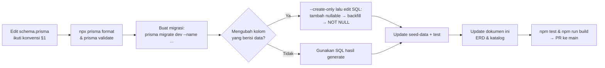

Checklist PR master data:
- [ ] Model memiliki `id`, `code @unique`, `name`, `isActive`, timestamps, `@@map` snake_case
- [ ] FK baru memakai `onDelete: Restrict` (atau `SetNull` jika memang opsional historis) + `@@index`
- [ ] Migrasi tidak menghapus data yang ada (backfill bila perlu)
- [ ] Seed idempotent & tes invarian diperbarui
- [ ] ERD dan katalog di dokumen ini diperbarui
