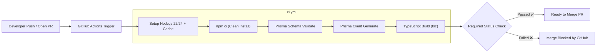

# Implementation Plan: CI Pipeline Setup & Branch Protection (GitHub Actions)

Membangun Continuous Integration (CI) pipeline pada repository [arrayan-be](https://github.com/Nongslab/arrayan-be) menggunakan **GitHub Actions**. CI ini berfungsi sebagai gerbang otomatis (*Quality Gate*) yang memverifikasi setiap Pull Request (PR) dan push branch sebelum diizinkan merge ke branch `main`.

---

## Status Repository & Branch Protection

> [!NOTE]
> - Repository [Nongslab/arrayan-be](https://github.com/Nongslab/arrayan-be) sudah berstatus **Public**.
> - **Update pasca-rencana**: workflow kini juga menjalankan `npm test` (Vitest) dan berjalan pada push ke semua branch — lihat `.github/workflows/ci.yml` sebagai sumber kebenaran.
> - **Branch Protection di `main` SUDAH AKTIF**: Direct push ke `main` diblokir otomatis oleh GitHub. Semua penambahan kode wajib melalui Pull Request (PR).
> - Job CI `Build & Typecheck` akan didaftarkan sebagai **Required Status Check** di GitHub branch protection (PR otomatis terkunci jika CI gagal/merah).

---

## Proposed Changes

Pipeline CI dirancang seringkas dan seefisien mungkin (runtime estimasi < 45 detik) dengan melakukan 3 lapis pengujian otomatis:
1. Validasi sintaks dan relasi skema database (`npx prisma validate`).
2. Generate Prisma Client (`npx prisma generate`).
3. Pemeriksaan tipe data dan kompilasi TypeScript murni (`npm run build`).



---

### CI/CD Workflow Configuration

#### [NEW] `.github/workflows/ci.yml`
File workflow GitHub Actions yang berisi instruksi automasi:

```yaml
name: CI Quality Gate

on:
  push:
    branches:
      - main
      - 'feat/**'
  pull_request:
    branches:
      - main

jobs:
  validate:
    name: Build & Typecheck
    runs-on: ubuntu-latest

    steps:
      - name: Checkout Source Code
        uses: actions/checkout@v4

      - name: Setup Node.js Environment
        uses: actions/setup-node@v4
        with:
          node-version: 22
          cache: 'npm'

      - name: Install Dependencies
        run: npm ci

      - name: Validate Prisma Schema
        run: npx prisma validate

      - name: Generate Prisma Client
        run: npx prisma generate

      - name: TypeScript Build Check
        run: npm run build
```

---

### Scripts & Package Setup

#### [MODIFY] `package.json`
Menambahkan script npm pendukung untuk mempermudah eksekusi lokal yang identik dengan CI:
- `npm run typecheck`: menjalankan `tsc --noEmit` untuk pengujian tipe kilat tanpa membuat folder `dist`.

```json
"scripts": {
  "dev": "tsx watch src/server.ts",
  "build": "tsc",
  "typecheck": "tsc --noEmit",
  ...
}
```

---

## Verification Plan

### Automated Tests (Simulasi Lokal Sebelum Push)
1. **Verifikasi Validitas Prisma Schema**:
   ```bash
   cd /Users/rakaiwangsasatia/arrayan-backend && npx prisma validate
   ```
2. **Verifikasi TypeScript Compilation**:
   ```bash
   cd /Users/rakaiwangsasatia/arrayan-backend && npm run build
   ```

### Manual Verification
1. Push branch `feat/setup-planning` ke GitHub remote dengan workflow baru.
2. Buat Pull Request ke `main` via GitHub CLI:
   ```bash
   gh pr create --title "chore: setup CI quality gate with GitHub Actions" --body "Menambahkan GitHub Actions CI untuk memvalidasi Prisma dan TypeScript build pada setiap PR."
   ```
3. Buka URL PR di browser dan amati:
   - GitHub Actions otomatis menjalankan job `Build & Typecheck`.
   - Tombol merge terproteksi dan menunggu hasil CI.
   - Status berubah menjadi **✅ All checks have passed**.

